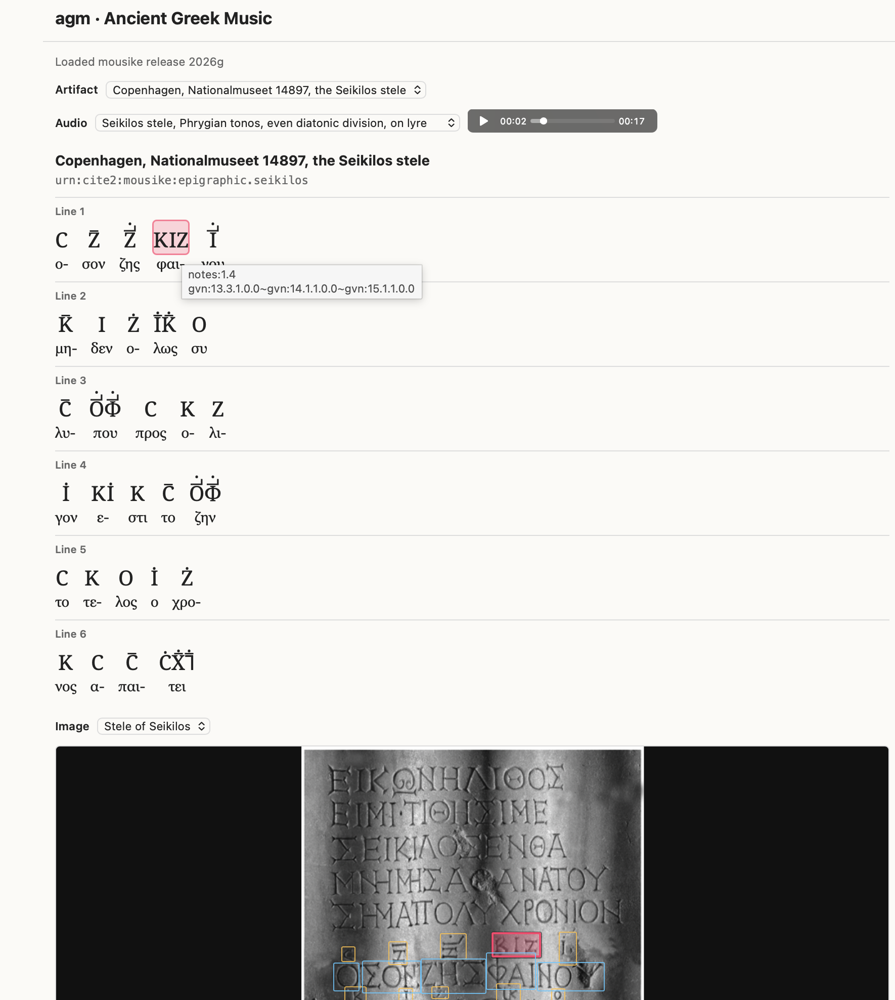

# agm

A web app for reading semantic editions of text with Ancient Greek musical notation.

- [documentation](https://neelsmith.github.io/agm/)
- a working installation of [the app](https://neelsmith.github.io/agm/agm.html)

