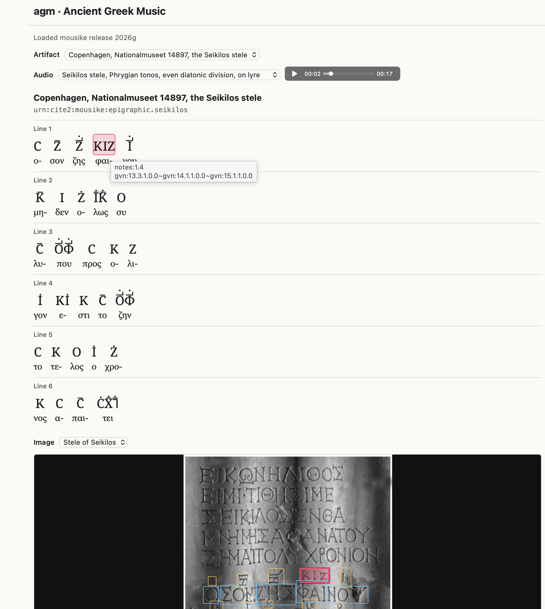

# agm

Web apps for reading semantic editions of text with Ancient Greek musical notation.

- [documentation](https://neelsmith.github.io/agm/)

Installations of the apps on github pages:

- [`agm-artifacts`](https://neelsmith.github.io/agm/agm-artifacts.html)
- [`agm-mss`](https://neelsmith.github.io/agm/agm-mss.html)
- [`agm-texts`](https://neelsmith.github.io/agm/agm-texts.html)

## Example: browsing by artifact 

