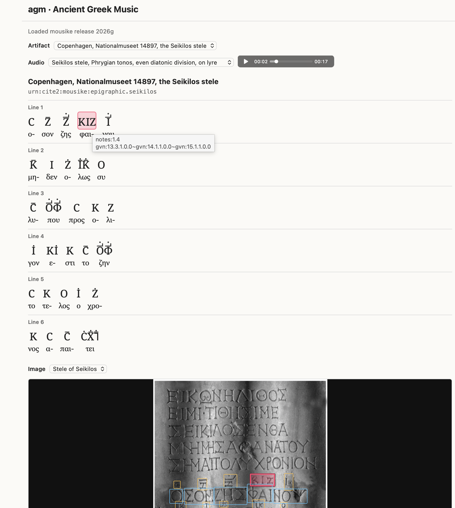

The `agm` repository hosts a suite of related a web apps for reading texts published in the [`mousike`](https://github.com/neelsmith/mousike) github project. Each app is a single HTML file that reads all its data over the internet. You can grab any of the HTML files from the [`agm` github repository]() to use it locally, or use one of these installations available on github pages;

- [`agm-artifacts`](https://neelsmith.github.io/agm/agm-artifacts.html): start from epigraphic and papyrological artifacts
- [`agm-mss`](https://neelsmith.github.io/agm/agm-mss.html): start from manuscript pages
- [`agm-texts`](https://neelsmith.github.io/agm/agm-texts.html): start from text editions

## Example: browsing by artifact

